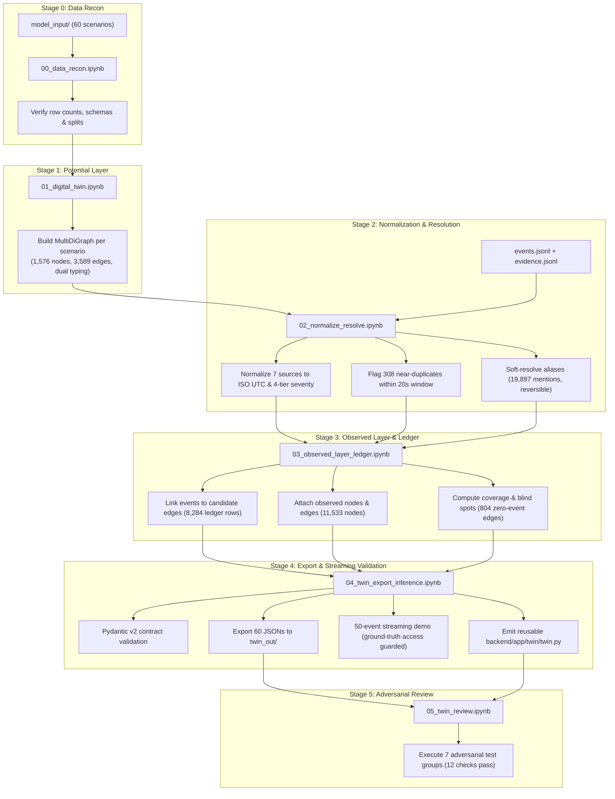

# Digital Twin — AttackTwin AI

**Workstream:** Digital Twin & Evidence Ingestion (Phase A)  
**Location:** [`docs/digital_twin/`](./)  
**Technical Handoff:** [`docs/digital_twin/HANDOFF.md`](./HANDOFF.md)  
**Audited Execution Report:** [`data_model/model/PHASE_A_EXECUTION_REPORT.md`](../../data_model/model/PHASE_A_EXECUTION_REPORT.md)  
**Core Pipeline Module:** [`backend/app/twin/twin.py`](../../backend/app/twin/twin.py)  
**Pipeline Notebooks:** [`notebooks/`](../../notebooks/)  
**Validated Graph Exports:** [`data_model/model/twin_out/`](../../data_model/model/twin_out/)  

---

## A. Overview

The **Digital Twin** is the graph compilation and telemetry ingestion engine of **AttackTwin AI**. It transforms raw, synthetic enterprise infrastructure data and heterogeneous security logs into a scenario-scoped, typed attack graph with an associated evidence ledger and telemetry coverage map.

### What the Digital Twin Is:
- A deterministic **graph compiler**: builds structured topological graphs from inventory assets and configuration relationships.
- A **telemetry normalizer**: parses, unifies, and standardizes multi-sensor logs into a common schema.
- An **entity resolver**: softly resolves obfuscated or aliased entity references (hostnames, IP addresses, emails, display names) without creating phantom merges.
- An **evidence ledger builder**: links observed security detections to candidate graph edges to quantify observable activity.
- A **coverage auditor**: computes sensor blind spots across infrastructure assets and network paths.

### What the Digital Twin Is NOT:
- **It is not the trained ML model.** The Digital Twin does not predict edge feasibility probabilities or train neural networks; that belongs to the downstream prior model (logistic regression / gradient boosting / heterogeneous GNN).
- **It is not a completed end-to-end risk platform.** It outputs the graph foundation (`nodes`, `edges`, `ledger`, `coverage`) for Monte Carlo risk reachability simulation and intervention analysis. It does not calculate end-to-end mission impact on its own.

---

## B. What the Digital Twin Currently Produces

The table below summarizes the exact outputs measured and verified in the Phase A execution audit:

| Entity / Metric | Verified Count | Operational Meaning |
|---|---:|---|
| **Scenarios Processed** | **60** | Independent enterprise infrastructure scenarios (36 train / 12 validation / 12 test). |
| **Potential Asset Nodes** | **1,576** | Enterprise compute, identity, data, service, and security control assets across all 60 scenarios. |
| **Potential Relationships** | **3,589** | Candidate infrastructure reachability, authentication, and privilege edges. |
| **Normalized Events** | **11,253** | Multi-sensor security telemetry rows unified to ISO-8601 UTC timestamps and canonical 4-tier severities. |
| **Input Evidence Rows** | **11,253** | Sensor reliability, collection confidence, and delay metadata paired 1-to-1 with events. |
| **Exported Evidence Ledger Rows** | **8,284** | Candidate event-to-edge linkages (including 292 predicted duplicate rows retained with zero weight for auditability). |
| **Observed Vulnerability Nodes** | **280** | Finding-derived vulnerability objects linked to affected assets via `EXPLOITS` edges. |
| **Observed Secret Nodes** | **0** | Secret scanning detections retain `Event` nodes only; location categories (`build_log`, `public_repository`) do not provide an unambiguous asset ID. |
| **Total Exported Graph Nodes** | **13,109** | Combined potential asset nodes (1,576), observed Event nodes (11,253), and Vulnerability nodes (280). |
| **Total Exported Graph Edges** | **22,586** | Combined potential edges (3,589), observed `AFFECTED_BY` edges (18,717), and `EXPLOITS` edges (280). |
| **Expanded Soft Merges Logged** | **19,961** | Traceable, reversible alias resolution records (`reversible=True`) preserving ambiguous candidates without physical node merging. |
| **Telemetry Coverage Blind Spots** | **804 edges / 52 nodes** | Potential edges (22.4%) and nodes (3.3%) with zero linked non-duplicate events. |
| **Validated Scenario JSON Exports** | **60 / 60** | Complete scenario JSON exports in `twin_out/` validated against Pydantic schema with zero errors. |

> [!IMPORTANT]
> **Semantic Interpretations of Outputs:**
> 1. **Potential Layer $\ne$ Attacker Reachability:** A potential edge represents configured or candidate connectivity. It is not ground-truth proof that an attacker can exploit or traverse that path.
> 2. **Observed Layer $\ne$ Attack Movement:** Observed nodes (`Event`, `Vulnerability`) and edges (`AFFECTED_BY`, `EXPLOITS`) represent sensor telemetry. They are strictly tagged `layer="observed"` to prevent path-search algorithms from routing through telemetry.
> 3. **Candidate Ledger Link $\ne$ Confirmed Evidence:** A ledger entry binds an event to an edge sharing the same entity endpoints. Events may be benign, defensive, or decoys.
> 4. **Zero Coverage $=$ Blind Spot, NOT Safety:** 804 edges have zero telemetry. The engine explicitly preserves their prior probability and flags them as blind spots rather than lowering risk.
> 5. **Soft Resolution $\ne$ Entity Merging:** Ambiguous display names (e.g., 64 mentions) retain multiple candidate IDs with lowered confidence weights rather than merging nodes into phantoms.

---

## C. Architecture & Pipeline Workflow

The Digital Twin executes as a deterministic, multi-stage pipeline:



---

## D. Notebook Guide

The canonical pipeline resides in [`notebooks/`](../../notebooks/). Notebooks must be executed sequentially:

| Order | Notebook File | Purpose | Key Audited Outputs |
|:---:|---|---|---|
| **00** | [`00_data_recon.ipynb`](../../notebooks/00_data_recon.ipynb) | Data reconnaissance and schema audit across all 7 model-input tables and splits. | Verified 60 scenarios, 1,576 assets, 3,589 edges, 11,253 events. Checked scenario-scoped aliases and confirmed zero broken relationship references. |
| **01** | [`01_digital_twin.ipynb`](../../notebooks/01_digital_twin.ipynb) | Potential graph construction per scenario with dual typing and intervention bindings. | 60 NetworkX `MultiDiGraph` instances, 433 shared identity groups, 362 intervention-linked edges. All 1,576 nodes and 3,589 edges retain exact dataset types. |
| **02** | [`02_normalize_resolve.ipynb`](../../notebooks/02_normalize_resolve.ipynb) | Multi-sensor normalization, sliding-window near-duplicate detection, and soft alias resolution. | 11,253 events parsed with 0 errors across 7 sources. 308 duplicates flagged; 19,897 alias mentions resolved (19,302 high, 531 medium, 64 low/ambiguous). |
| **03** | [`03_observed_layer_ledger.ipynb`](../../notebooks/03_observed_layer_ledger.ipynb) | Evidence ledger generation, observed layer construction, and coverage/blind-spot mapping. | 8,284 ledger rows (2,785 distinct linked edges). 11,253 Event nodes, 280 Vulnerability nodes, 0 Secret nodes. 804 blind-spot edges and 52 blind-spot nodes identified. |
| **04** | [`04_twin_export_inference.ipynb`](../../notebooks/04_twin_export_inference.ipynb) | Contract enforcement with Pydantic v2, scenario JSON serialization, and streaming demo. | 60 scenario JSON files exported to `twin_out/` (60/60 validate and reload). 4-batch streaming inference demo executes with ground-truth access guard active. Emits `twin.py`. |
| **05** | [`05_twin_review.ipynb`](../../notebooks/05_twin_review.ipynb) | Adversarial stress testing and pipeline integrity checks. | 7 adversarial groups pass (duplicate display names, parallel candidates, zero-coverage safety, cross-scenario ID collision, malformed input rejection). |

### Legacy Notebook Notice
- `notebooks/01_build_graphs.ipynb` is a **legacy artifact** preserved for baseline comparison. It has been superseded by `01_digital_twin.ipynb` and is not part of the active pipeline.

---

## E. Inputs, Outputs, and Directory Structure

### 1. Repository-Relative Paths

```
Gossip_protocol/
├── data_model/
│   ├── dataset/
│   │   └── attack_path_dataset/
│   │       └── data/
│   │           ├── model_input/       <-- CONSUMED BY TWIN (Input Tables)
│   │           │   ├── scenarios.jsonl
│   │           │   ├── assets.jsonl
│   │           │   ├── relationships.jsonl
│   │           │   ├── events.jsonl
│   │           │   ├── evidence.jsonl
│   │           │   ├── interventions.jsonl
│   │           │   └── what_if.jsonl
│   │           ├── ground_truth/      <-- EVAL ONLY (Forbidden during inference)
│   │           │   ├── ground_truth.jsonl
│   │           │   └── normalized_events.jsonl
│   │           └── splits.json        <-- 36 train / 12 validation / 12 test
│   └── model/
│       ├── notebooks/                 <-- 00 through 05 canonical pipeline
│       ├── phase_a_audit/             <-- Runner, execution logs, and metrics
│       │   ├── run_notebooks.py
│       │   ├── write_report.py
│       │   └── execution.json
│       ├── twin_out/                  <-- GENERATED EXPORTS (60 JSONs + index)
│       │   ├── index.json
│       │   └── scn_0001.json ... scn_0060.json
│       ├── twin.py                    <-- Emitted reusable pipeline module
│       └── PHASE_A_EXECUTION_REPORT.md<-- Comprehensive audit report
└── docs/
    └── digital_twin/
        ├── README.md                  <-- This document
        └── HANDOFF.md                 <-- In-depth developer handoff
```

### 2. Runtime vs. Evaluation Ground-Truth Separation
- **Runtime Inference (`model_input/`):** All production twin functions (`normalise_event`, `resolve_events`, `run_dedup`, `build_ledger`, `export_graph_json`) read strictly from `data/model_input/`.
- **Offline Evaluation (`ground_truth/`):** Files in `data/ground_truth/` are restricted to offline benchmarking cells labeled `EVAL ONLY`. During the Prompt 4 inference demo, a dynamic interceptor (`builtins.open`) asserts that any runtime access to `ground_truth/` raises `AssertionError`.

---

## F. How to Run and Reproduce

### 1. Environment Prerequisites
- Python 3.10+ (tested on Python 3.13.1)
- Packages: `networkx >= 3.2.1`, `pydantic >= 2.6.0`, `nbformat`, `nbclient`, `ipykernel`

Install dependencies:
```bash
pip install networkx pydantic nbformat nbclient ipykernel
```

### 2. Automated Pipeline Execution
To execute all six canonical notebooks in sequential order with fresh Python kernels and verify their output checkpoints:

```powershell
# From the repository root:
python phase_a_audit/run_notebooks.py
```

To regenerate the audit report from the execution logs:
```powershell
python data_model/model/phase_a_audit/write_report.py
```

### 3. Reusing the Pipeline in Python Code
To import the tested twin pipeline functions directly into your script or service:

```python
import sys
from pathlib import Path

# Add data_model/model to path
sys.path.insert(0, str(Path("data_model/model").resolve()))

from twin import (
    build_potential_graph,
    normalise_event,
    resolve_events,
    run_dedup,
    build_ledger,
    compute_coverage,
    build_observed_layer,
    export_graph_json,
)
```

*(Note: The current backend in `backend/app/twin/graph.py` currently uses an internal `SecurityDigitalTwin` class. Wiring the Phase A `backend/app/twin/twin.py` module into the API is an upcoming integration task).*

---

## G. Current Status and Key Limitations

While all 175 named execution checks passed in the Phase A audit, **execution success is not equivalent to complete ML or risk integration**:

1. **Unpopulated Probabilities:** Exported graph edge fields `p` and `variance` are currently `null`. They are reserved for the upcoming calibrated ensemble prior / BGNN.
2. **Coarse Plan Vocabulary:** Plan types currently use coarse categories (`identity`, `host`, `service`, `data`, `control`) rather than the proposed canonical names (`Identity`, `Endpoint`, `Server`). Original schema `dataset_type` is strictly preserved.
3. **Candidate Ledger Precision (~29.9%):** Candidate edge linking connects events by matching endpoint pairs. Because non-attack and background events share infrastructure endpoints, precision against labelled ground-truth support is 29.93% (recall is 100%). Downstream models must treat ledger links as candidate signals, not ground truth.
4. **Zero Secret Nodes:** The current build creates 0 Secret nodes because raw secret scan location fields (e.g. `build_log`) do not reliably identify asset IDs; these events safely fallback to `Event` nodes.
5. **Deferred Temporal Checking:** Causal order validation across event sequences is currently skipped; zero warnings does not imply verified chronological feasibility.
6. **Synthetic Generator Fit:** All evaluation numbers measure calibration to this specific synthetic generator. Real-world transfer and generalization to unseen scenario templates have not been evaluated.

---

## H. Disclosures

- **Synthetic Data Disclosure:** All telemetry, infrastructure assets, network topologies, user identities, and `SYN-` CVE IDs in this repository are entirely synthetic. No proprietary or real-world customer telemetry is contained herein.
- **AI-Assisted Development Disclosure:** Development and code audits across the digital twin workstream were assisted by AI pair-programming tools (Google Antigravity IDE with Claude 3.7 Sonnet and Gemini 2.5 Flash). All generated code, tests, and metrics were executed and validated against live local Python kernels.
